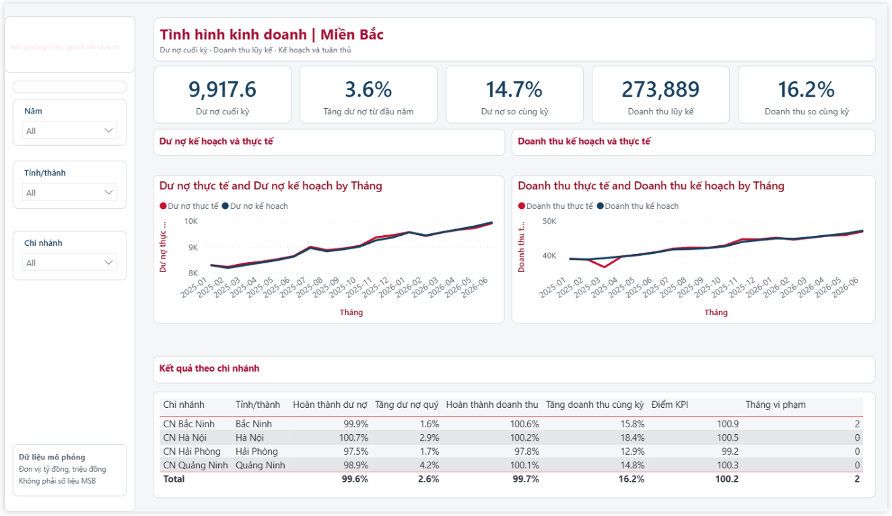
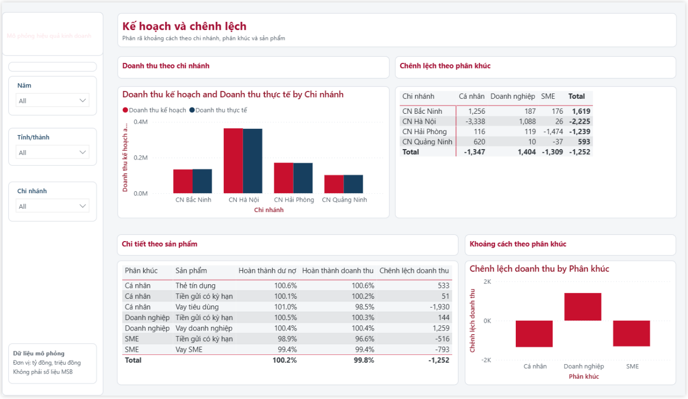
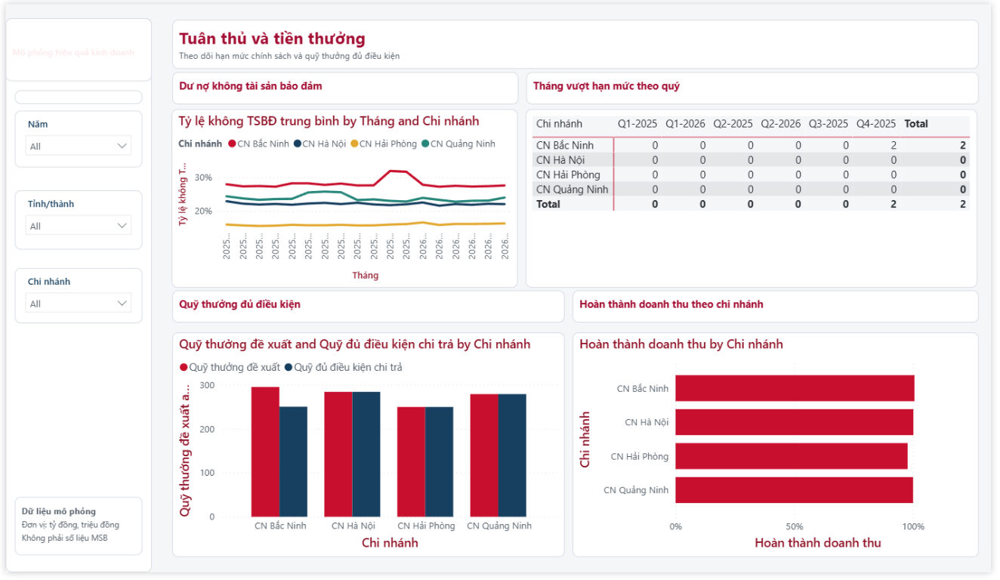
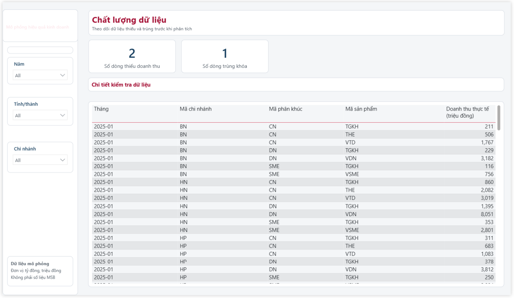

# Bank Business Performance & KPI Dashboard

Project portfolio mô phỏng quy trình phân tích hiệu quả kinh doanh ngân hàng:
từ xác định câu hỏi quản trị, chuẩn hóa KPI, kiểm tra dữ liệu, phân tích kế hoạch
so với thực tế, đến xây dựng dashboard và đề xuất hành động. Dự án tập trung vào
cách biến số liệu theo tháng thành thông tin có thể dùng để theo dõi hiệu suất
chi nhánh, nhận diện rủi ro và hỗ trợ quyết định.

## Mục tiêu nghiệp vụ

Dự án trả lời các câu hỏi chính:

- Chi nhánh, phân khúc và sản phẩm nào đang đạt hoặc lệch kế hoạch? Mức lệch bắt
	nguồn từ dư nợ, doanh thu hay số khách hàng mới?
- Cơ chế KPI và incentive có khuyến khích tăng trưởng phù hợp, đồng thời tôn
	trọng giới hạn chính sách không?
- Các lỗi thiếu dữ liệu, trùng khóa hoặc sai khóa tham chiếu ảnh hưởng thế nào
	đến số liệu báo cáo?
- Nhà quản lý nên ưu tiên hành động nào, theo dõi bằng chỉ số nào và trong thời
	gian nào?

Danh sách câu hỏi đầy đủ nằm trong
[01_project_scope/business_questions/business_questions.md](01_project_scope/business_questions/business_questions.md).

## Phạm vi và dữ liệu

Repository có hai kịch bản dữ liệu mô phỏng, cần được đọc riêng biệt:

| Kịch bản | Phạm vi | Mục đích |
|---|---|---|
| Dữ liệu tổng quát | 6 chi nhánh, 3 phân khúc, 5 sản phẩm; tháng 01/2025 đến 06/2026 | Phân tích toàn bộ câu chuyện kinh doanh, variance, KPI, incentive và chất lượng dữ liệu |
| Miền Bắc | 4 chi nhánh tại Hà Nội, Hải Phòng, Quảng Ninh và Bắc Ninh; tháng 01/2025 đến 06/2026 | Kịch bản dashboard theo tỉnh, có đặc điểm địa bàn và phát hiện riêng |

Dữ liệu tổng quát được sinh bằng `02_data/scripts/generate_simulated_data.py`;
dữ liệu miền Bắc được sinh bằng
`02_data/north_provinces/generate_north_sim.py`. Cả hai dùng seed cố định để có
thể tái lập. Các tên đơn vị, quy mô, chính sách và kết quả đều là giả lập, không
đại diện cho ngân hàng hay địa phương thực tế.

Đơn vị quy ước: dư nợ/huy động tính bằng tỷ VND; doanh thu và incentive tính
bằng triệu VND. Kỳ báo cáo là tháng. Tỷ lệ hoàn thành tổng hợp được tính bằng
tổng thực tế chia tổng kế hoạch, không lấy trung bình các tỷ lệ ở cấp dòng.

## Cách tiếp cận

1. Xác định câu hỏi quản trị và định nghĩa KPI dùng chung.
2. Tổ chức dữ liệu theo fact và dimension; kiểm tra khóa, giá trị thiếu và tính
	 nhất quán giữa các bảng.
3. Dùng SQL để tổng hợp plan vs actual, kiểm tra chính sách và tạo các chỉ số
	 phân tích.
4. Phân tích chênh lệch theo thời gian, chi nhánh, phân khúc và sản phẩm; đưa
	 kết quả vào dashboard Power BI.
5. Chuyển phát hiện thành khuyến nghị có chỉ số theo dõi, đồng thời ghi rõ giả
	 định và giới hạn của dữ liệu.

Các ngưỡng chính trong từ điển KPI: đạt từ 100%, cảnh báo từ 95% đến dưới 100%,
và cần chú ý dưới 95%. Hạn mức cho vay không có tài sản bảo đảm 30%, trần hoa
hồng 3,5%, trọng số KPI 60/40 và công thức incentive đều là giả định minh họa,
không phải chính sách thật. Xem
[01_project_scope/kpi_dictionary/kpi_dictionary.md](01_project_scope/kpi_dictionary/kpi_dictionary.md)
và [08_documentation/assumptions.md](08_documentation/assumptions.md) trước khi
diễn giải kết quả.

## Kết quả nổi bật

Các phát hiện dưới đây thuộc **bộ dữ liệu tổng quát**, không phải kết quả của
kịch bản miền Bắc:

- Tổng thể bám sát kế hoạch có thể che khuất vấn đề ở cấp chi nhánh-phân khúc.
	CN Huế - SME là điểm lệch lớn nhất, với chênh lệch doanh thu khoảng -7.328
	triệu VND; phân tích cho thấy số khách hàng mới thấp là driver chính.
- CN Cần Thơ vi phạm hạn mức cho vay không tài sản bảo đảm trong 4 tháng cuối
	năm 2025 nhưng vẫn đạt KPI ở một số tháng, cho thấy incentive chưa gắn với
	điều kiện tuân thủ.
- CN Đà Nẵng - thẻ tín dụng vượt kế hoạch trong Q4/2025; cần phân biệt tăng
	trưởng nền với tác động chiến dịch khi lập kế hoạch tiếp theo.
- Dữ liệu có lỗi thiếu và trùng được cài chủ đích để minh họa tác động của kiểm
	soát chất lượng dữ liệu đến báo cáo.

Chi tiết và giới hạn diễn giải ở
[04_analysis/variance_drivers/variance_analysis.md](04_analysis/variance_drivers/variance_analysis.md)
và [06_recommendations/recommendations.md](06_recommendations/recommendations.md).
Đối với kịch bản miền Bắc, phát hiện và số kiểm tra dashboard được mô tả riêng
trong [05_dashboard/powerbi/dashboard_spec_north.md](05_dashboard/powerbi/dashboard_spec_north.md).

## Giao diện dashboard

Bốn trang dưới đây thuộc kịch bản mô phỏng miền Bắc, minh họa cách theo dõi hiệu
quả kinh doanh, chênh lệch kế hoạch, tuân thủ và chất lượng dữ liệu. Số liệu
trong ảnh là dữ liệu giả lập, không đại diện cho ngân hàng thực tế. Xem
[đặc tả dashboard miền Bắc](05_dashboard/powerbi/dashboard_spec_north.md) để biết
thêm về KPI và cách đọc báo cáo.

### 01 · Tình hình kinh doanh

Theo dõi KPI tổng quan, xu hướng thực tế so với kế hoạch và kết quả từng chi
nhánh.

### 02 · Kế hoạch và chênh lệch

Xác định khoảng cách kế hoạch theo chi nhánh, phân khúc và sản phẩm.

### 03 · Tuân thủ và tiền thưởng

Đặt kết quả KPI và quỹ thưởng trong bối cảnh giới hạn chính sách.

### 04 · Chất lượng dữ liệu

Hiển thị các bản ghi thiếu hoặc trùng cần được kiểm tra trước khi phân tích.

## Cấu trúc

- `01_project_scope/`: câu hỏi nghiệp vụ và từ điển KPI.
- `02_data/`: dữ liệu giả lập tổng quát, dữ liệu miền Bắc, dữ liệu tham chiếu và
	script sinh dữ liệu.
- `03_sql/`: truy vấn plan vs actual, chính sách, incentive và kiểm tra chất
	lượng dữ liệu.
- `04_analysis/`: phân tích variance, driver và dự báo xu hướng.
- `05_dashboard/powerbi/`: đặc tả dashboard, project Power BI và semantic model
	dạng TMDL.
- `06_recommendations/`: khuyến nghị quản trị dựa trên phân tích.
- `07_presentation/`: dàn ý trình bày project.
- `08_documentation/`: giả định, quy ước và hạn chế.

## Bắt đầu khám phá

- Muốn hiểu bài toán: đọc câu hỏi nghiệp vụ và từ điển KPI trong `01_project_scope/`.
- Muốn kiểm tra logic dữ liệu: xem `02_data/`, sau đó chạy/đọc truy vấn trong
	`03_sql/`; các kiểm tra chất lượng nằm ở `03_sql/data_quality_checks/`.
- Muốn hiểu kết quả: bắt đầu từ `04_analysis/variance_drivers/` và
	`06_recommendations/`.
- Muốn xem thiết kế báo cáo: đọc `05_dashboard/powerbi/dashboard_spec.md` cho
	kịch bản tổng quát hoặc `dashboard_spec_north.md` cho miền Bắc.
- Muốn trình bày project: tham khảo `07_presentation/presentation_outline.md`.

## Dữ liệu và quyền riêng tư

Đây là project thực hành độc lập. Chỉ sử dụng dữ liệu giả lập hoặc dữ liệu công
khai phù hợp; không đưa dữ liệu khách hàng, dữ liệu nội bộ ngân hàng, thông tin
đăng nhập hoặc bí mật lên repository. Các công thức KPI, giới hạn chính sách,
dự báo và khuyến nghị trong project chỉ nhằm minh họa phương pháp; không dùng
như kết luận hay tư vấn cho một tổ chức thực tế.

## Tự động push sau mỗi commit

Repository này dùng Git hook tại `.githooks/post-commit` để push commit hiện
tại lên `origin` sau khi commit hoàn tất. Hook chỉ được kích hoạt trong bản
clone đã cấu hình `core.hooksPath`; xem README của repository để biết cách bật
trên máy khác.
